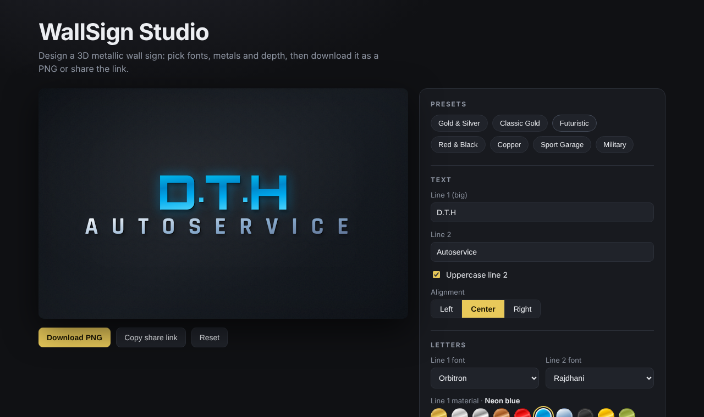

# WallSign Studio

A small browser tool for designing a **3D metallic wall sign** – the kind you see above a garage or shop entrance. Pick the text, fonts, metals and wall, then download the result as a high-resolution PNG or share it as a link.



**Live demo:** https://mirceah.github.io/wallsign-studio/

It started as a single HTML/CSS sign I built for a car-service business ([dth-autoservice-sign](https://github.com/MirceaH/dth-autoservice-sign)) and grew into a configurable React + TypeScript app.

## Features

- 7 presets and 11 metal materials (gold, silver, chrome, copper, neon, ice, …), chosen separately for each line
- 9 bundled display fonts (no external font requests, works offline)
- Live preview with adjustable letter size, spacing, depth of the shadow and alignment
- **Download PNG** – the sign is re-drawn on a canvas at 2000 px wide, independent of screen size
- **Share link** – the whole design is stored in the URL hash (base64url JSON), so there is no backend
- Input is validated on load: unknown ids and out-of-range numbers fall back to safe defaults
- Keyboard accessible controls, `prefers-reduced-motion` respected

## How it works

- The letters are plain text with a metallic `linear-gradient` painted through `background-clip: text`; depth comes from stacked `drop-shadow()` filters.
- Sizes use CSS container query units (`cqw`), so the sign scales exactly with the preview box and the canvas export uses the same layout numbers (`src/lib/layout.ts`).
- State lives in one `SignConfig` object. `src/lib/config.ts` holds the types, presets, `sanitize()` and the URL (de)serialisation, which keeps the React components thin.

A bug worth remembering: setting the `background` shorthand from React resets `background-clip`, which turned the letters into solid blocks after a material change. The gradient is set with `backgroundImage` instead.

## Run it

```bash
npm install
npm run dev        # http://localhost:5173
npm test           # vitest (share-link round trip, sanitising, helpers)
npm run lint       # oxlint
npm run build      # type-check + production build
```

## Stack

React 19, TypeScript (strict), Vite, Vitest, oxlint, GitHub Pages deployment through GitHub Actions.

## Related projects

- [puzzle-lab](https://github.com/MirceaH/puzzle-lab) – 8-puzzle search algorithm visualiser (React + TypeScript)
- [dth-autoservice-sign](https://github.com/MirceaH/dth-autoservice-sign) – the original HTML/CSS sign
